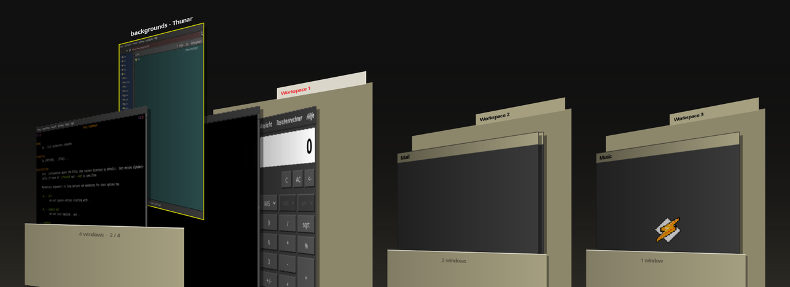

# windowfiler

A workspace overview for X11 desktops, drawn as a filing drawer: every
workspace is a manila folder, every window a sheet filed inside it.



The folders stand side by side along the bottom of the screen, all turned to
the same angle. The current workspace's folder stands a little higher with its
windows filed left to right; the highlighted window is lifted half out of the
folder with its title above it. The other folders are closed, only as thick as
the number of windows they hold, with their sheets peeking out.

## Using it

| | |
|---|---|
| ← → or scroll | leaf through the open folder |
| click a sheet | highlight it; click the highlighted sheet (or Enter) to switch to that window |
| drag a sheet onto another folder | move the window to that workspace |
| click a folder | open it |
| double-click a folder | go to that workspace |
| 1–9, PgUp/PgDn | open a folder |
| Esc, or click empty space | leave |

```
windowfiler          open the overview, or close it if it is open
windowfiler open     open it
windowfiler close    close it and switch to the highlighted window
```

Labels are in English, or German when your locale is `de_*`.

## Light on the system

- **Nothing runs while it is closed.** There is no daemon and no background
  thumbnailing.
- When it opens, windows on the current workspace are captured live. The X
  server does the scaling (XRender), one window per frame after the first, so
  the opening animation keeps moving.
- Windows on other workspaces are unmapped, so X has no picture of them; they
  get a generic preview (a little window with the title and app icon).
- Each angled sheet is rendered once into a server-side surface; animating is
  just compositing those.
- `windowfiler close` talks to an open overview before loading GTK, so a
  gesture closes it instantly.

## Install

Dependencies: Python 3, PyGObject, GTK 3, libwnck 3 and pycairo. On Arch:

```sh
sudo pacman -S python-gobject gtk3 libwnck3 python-cairo
```

Then put the script on your `PATH`:

```sh
install -m755 windowfiler ~/.local/bin/
```

A compositing window manager is recommended (xfwm4's compositor, picom, …):
with compositing, windows covered by others are still captured correctly.

### Keyboard shortcut (Xfce)

```sh
xfconf-query -c xfce4-keyboard-shortcuts -p "/commands/custom/<Super>w" -n -t string -s "$HOME/.local/bin/windowfiler"
```

### Three-finger swipes (touchégg)

Swipe up to open, swipe down to close on the highlighted window. Add this
inside `<application name="All">` in `~/.config/touchegg/touchegg.conf`
(see [`touchegg-example.conf`](touchegg-example.conf)):

```xml
<gesture type="SWIPE" fingers="3" direction="UP">
  <action type="RUN_COMMAND">
    <repeat>false</repeat>
    <command>windowfiler open</command>
    <on>begin</on>
  </action>
</gesture>

<gesture type="SWIPE" fingers="3" direction="DOWN">
  <action type="RUN_COMMAND">
    <repeat>false</repeat>
    <command>windowfiler close</command>
    <on>begin</on>
  </action>
</gesture>
```

## Notes

- X11 only: it uses libwnck for the window list and reads window pictures
  from the X server. It does nothing useful on Wayland.
- While it is open it holds the pointer and keyboard, like a menu.
- The khaki-and-charcoal palette comes from the IndigoMagic (SGI IRIX) theme.

## Licence

MIT, see [LICENSE](LICENSE).
